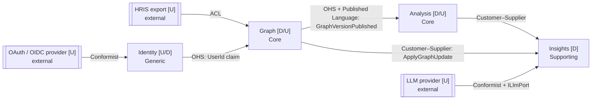
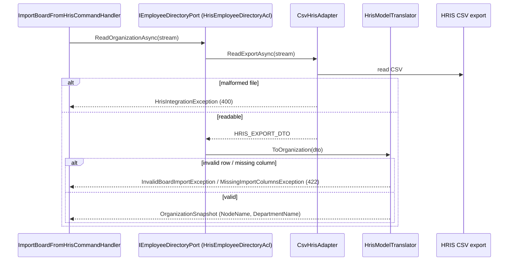

# Context Map and ACL

## 1. Subdomains and Bounded Contexts

| Context | Classification | Main aggregates (Lab 2) | Business justification | Microarchitecture |
| --- | --- | --- | --- | --- |
| **Graph** | Core | `Board` (`Node`, `Connection`), `GraphVersion`, `OrganizationImport` | ONA's value starts with an accurate, versioned organization network; graph rules (no self/duplicate links, immutable published versions) are ours and change with every new data source. | Rich Domain Model + Clean Architecture – invariants and the Board state machine need unit tests without a database. |
| **Analysis** | Core | `AnalysisRun` | Bottleneck detection is the product's differentiator; thresholds and the "administrative activity vs. real bottleneck" policy will change often. | Rich Domain Model + Hexagonal – metric policies as strategies, runs must be reproducible for one `GraphVersionId`. |
| **Insights** | Supporting | `Recommendation` | Needed to turn metrics into advice, but text generation is bought from an LLM provider; our part is delivery and the approve/reject workflow. | Transaction Script + adapter behind a generator port – few rules, main risk is the external call. Implemented as `IInsightGeneratorPort` with a rule-based generator; an LLM adapter (`ILlmPort` in the original design) can replace it. |
| **Identity** | Generic | `User` | Registration and login are solved the same way everywhere; the target is an OAuth/OIDC provider. Implemented: local accounts (PBKDF2 password hash, HS256 JWT, password reset by email). | Integration – thin adapter, provider model accepted as is (target); local `User` aggregate for now. |

### Bounded Context Canvas – Graph (Core)

| Section | Content |
| --- | --- |
| Name and purpose | **Graph** – build and keep a consistent, versioned network of people (nodes) and relationships (connections) from organization data. |
| Classification | Core subdomain; role: system of record for the organization network. |
| Ubiquitous Language | **Board** – one organization network; **Node** – a person; **Connection** – directed, weighted relationship; **ConnectionWeight** – strength > 0; **Reporting line** – supervisor → employee connection; **GraphVersion** – immutable published snapshot; **Lifecycle** – Draft / Built / Published / Archived; **OrganizationImport** – one submitted HR export. |
| Business rules | Connection endpoints belong to the same Board; no self-connection; one connection per direction; weight finite and > 0; empty graph cannot be built; Published graph is immutable; Published board cannot be deleted (see `stateDiagram-analysis.md`). |
| Incoming | Commands: `CreateBoard`, `RenameBoard`, `ImportBoardFromHris`, `BuildBoardGraph`, `PublishBoard`, `ArchiveBoard`, `DeleteBoard`; nodes and connections are added, changed and removed through `IGraphService`; `ApplyGraphUpdate` (target, from Insights, not implemented). Queries: `GetBoardById`, `GetAllBoards`, `GetGraphSnapshot`, `PreviewCsv`, nodes/connections by board. |
| Outgoing | Event `GraphVersionPublished { board_id, graph_version_id }` for Analysis (Kafka, ADR-007) and `GET /boards/{id}/snapshot`. `NetworkGraphBuilt` is a target event, not implemented. |
| Dependencies | HRIS export (ACL), Analysis (consumes versions), Insights (requests approved updates), Identity (`UserId` only). |

## 2. Context Map



Arrows point from Upstream [U] to Downstream [D]. Implemented: HRIS → Graph (ACL); Graph → Analysis (event `GraphVersionPublished` + `GET /boards/{id}/snapshot`); Analysis → Insights (event `AnalysisCompleted` + `GET /analysis-runs/{id}`); Identity → all (JWT, see ADR-007). `ApplyGraphUpdate`, the LLM provider and the OIDC provider are not implemented (rule-based generator and local login instead).

| Relationship | Pattern | Who dictates the model | Why | Main risk |
| --- | --- | --- | --- | --- |
| HRIS → Graph | Anti-Corruption Layer | HRIS (we cannot change the export) | Foreign column names (`EmpID`, `DepartmentType`), `NaN` as empty, many personal-data columns we must not store | Translator must follow every export change |
| Graph → Analysis | Open Host Service + Published Language | Graph | Analysis must read one stable, immutable snapshot identified by `GraphVersionId` | Versioning the snapshot contract |
| Analysis → Insights | Customer–Supplier | Analysis, Insights can request fields | Same company and vocabulary (metrics, bottlenecks); Insights needs `AnalysisRunId` for provenance | Insights blocked when Analysis priorities differ |
| Graph → Insights | Customer–Supplier | Graph | Only an approved `Recommendation` may request `ApplyGraphUpdate`; Graph keeps its invariants | Update requests rejected if the version changed |
| LLM provider → Insights | Conformist (port kept) | LLM provider | Supporting context; provider API is clean, we only need prompt in / text out | Provider changes and outages; mitigated by `ILlmPort` |
| OIDC provider → Identity | Conformist | OIDC standard | Generic problem, open standard | Lock-in to provider features |
| Identity → Graph | Open Host Service | Identity | Other contexts need only a `UserId` claim, not the `User` model | Claim format changes |

No Shared Kernel: contexts share only identifiers passed in contracts (`BoardId`, `GraphVersionId`, `AnalysisRunId`, `UserId`).

## 3. ACL: Graph ← HRIS

**Flow** (success and error paths):



**Port**:
```csharp
public interface IEmployeeDirectoryPort
{
    // mapping == null -> the HRIS column names below (all six columns required)
    Task<OrganizationSnapshot> ReadOrganizationAsync(Stream csv, ColumnMapping? mapping = null, CancellationToken ct = default);
    Task<CsvPreview> PreviewAsync(Stream csv, CancellationToken ct = default);   // columns, first rows, suggested mapping
}
```

Returns `OrganizationMember(EmployeeId, NodeName Name, Title, DepartmentName Department, SupervisorEmployeeId?)` – `NodeName` and `DepartmentName` are Lab 2 Value Objects.

**Classes** (`Infrastructure/Acl`, `internal sealed`): `HRIS_EXPORT_DTO`, `HRIS_EMPLOYEE_DTO`, `CsvHrisAdapter` (I/O), `HrisModelTranslator` (mapping), `HrisEmployeeDirectoryAcl` (facade).

**Mapping** (values trimmed; empty or exactly `NaN` = no value – `Nan` is a real first name; row 2 = first employee):

| # | HRIS | Ours | Rule |
| -- | --- | --- | --- |
| 1 | missing required column | `MissingImportColumnsException` | `board_import.missing_columns` |
| 2 | no rows | `InvalidBoardImportException` | `board_import.invalid` |
| 3 | `EmpID` | `EmployeeId` | required |
| 4 | duplicate `EmpID` | `InvalidBoardImportException` | |
| 5 | `FirstName` + `LastName` | `NodeName` | joined with a space |
| 6 | `Title` | `Title` | required |
| 7 | `DepartmentType` | `DepartmentName` | required |
| 8 | `Supervisor` empty / `NaN` | `null` | top of hierarchy |
| 9 | `Supervisor` = known `EmpID` | `SupervisorEmployeeId` | connection supervisor → employee, weight 1.0; an `EmpID` match wins over a name match |
| 10 | `Supervisor` = own `EmpID` or own full name | `InvalidBoardImportException` | |
| 11 | `Supervisor` = full name (`FirstName LastName`, trimmed, case-insensitive) of exactly one employee | `SupervisorEmployeeId` of that employee | the real HRIS export names supervisors, it does not give their `EmpID` |
| 14 | `Supervisor` matches no employee (or a name shared by several) | placeholder member | one per distinct value (case-insensitive): `EmployeeId` `ext:<value>`, name = value, title `Supervisor (not in export)`, department `External`, no supervisor. A mistyped `EmpID` therefore creates a placeholder instead of an error |
| 12 | unreadable / malformed CSV | `HrisIntegrationException` | HTTP 400 |
| 13 | other columns | – | ignored |

### Any CSV: column mapping

The HRIS table above is the built-in mapping. For any other people table the caller sends a `ColumnMapping` (CSV header names; `null` = not mapped) and the same rules apply with the mapped columns:

| Role | Rule when mapped | When not mapped |
| --- | --- | --- |
| `FullName` | one name column, required; wins over first/last | – |
| `FirstName`, `LastName` | each mapped one is required; joined with a space | – |
| `EmployeeId` | required, unique | generated `row-<file row>`; supervisors can then only match by name |
| `Title` | required | `Employee` |
| `Department` | required | `General` |
| `Supervisor` | rows 8–11 and 14 above | no reporting lines |

- A name source is mandatory: `FullName`, or at least one of `FirstName` / `LastName` → else `InvalidColumnMappingException` (`board_import.invalid_mapping`).
- A mapped column that is not in the header → `MissingImportColumnsException`.
- Bad rows still reject the whole file (`InvalidBoardImportException`, message names the mapped column and the row).
- `PreviewAsync` returns the header, up to 5 rows, the row count and a **suggested** mapping guessed from common header names (`Employee ID`, `Full Name`, `Job Title`, `Reports To`, …). Only a suggestion: the caller confirms it.
