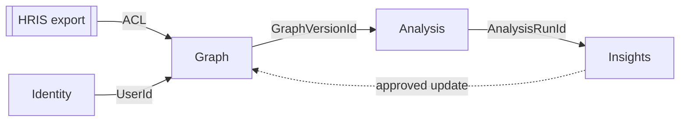

# Context Map and ACL

## Contexts

| Context | Type | Responsibility |
| --- | --- | --- |
| Graph | Core | `Board` (nodes, connections, lifecycle), HRIS import |
| Analysis | Core (scaffold) | `AnalysisRun` per `GraphVersionId` |
| Insights | Supporting (scaffold) | `Recommendation` from analysis |
| Identity | Generic (scaffold) | `User` |
| HRIS | External | Employee CSV export |

## ACL: Graph ← HRIS

**Port** (`Application/Ports/IEmployeeDirectoryPort.cs`):
`Task<OrganizationSnapshot> ReadOrganizationAsync(Stream employeeExport, CancellationToken ct)`
returns `OrganizationMember(EmployeeId, NodeName Name, Title, DepartmentName Department, SupervisorEmployeeId?)`.

**Classes** (`Infrastructure/Acl`, `internal sealed`): `HRIS_EXPORT_DTO`, `HRIS_EMPLOYEE_DTO`, `CsvHrisAdapter` (I/O), `HrisModelTranslator` (mapping), `HrisEmployeeDirectoryAcl` (facade).

**Mapping** (values trimmed; empty or `NaN` = no value; row 2 = first employee):

| # | HRIS | Ours | Rule |
| -- | --- | --- | --- |
| 1 | missing required column | `MissingImportColumnsException` | `board_import.missing_columns` |
| 2 | no rows | `InvalidBoardImportException` | `board_import.invalid` |
| 3 | `EmpID` | `EmployeeId` | required |
| 4 | duplicate `EmpID` | `InvalidBoardImportException` | |
| 5 | `FirstName` + `LastName` | `NodeName` | joined with a space |
| 6 | `Title` | `Title` | required |
| 7 | `DepartmentType` | `DepartmentName` | required |
| 8 | `Supervisor` empty / `NaN` | `null` | top of hierarchy |
| 9 | `Supervisor` = known `EmpID` | `SupervisorEmployeeId` | connection supervisor → employee, weight 1.0 |
| 10 | `Supervisor` = own `EmpID` | `InvalidBoardImportException` | |
| 11 | `Supervisor` unknown | `InvalidBoardImportException` | |
| 12 | unreadable / malformed CSV | `HrisIntegrationException` | HTTP 400 |
| 13 | other columns | – | ignored |
