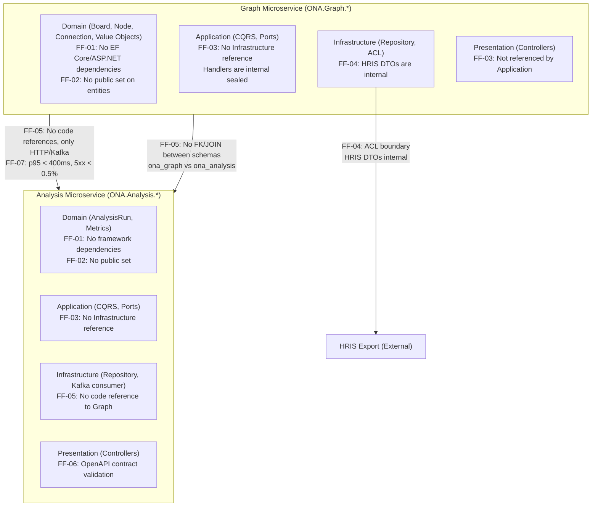

# Architectural Fitness Functions

## Stage 1: Guards for Layer Purity and Domain Model (FF-01..FF-04)

| ID | Guard name | Scope (Layer / Namespace) | Verifiable rule (Technical predicate) | What AI / developer mistake does it stop? | Verification tool |
| --- | --- | --- | --- | --- | --- |
| **FF-01** | Technological purity of the Domain layer | All types in `ONA.*.Domain` projects (e.g., `ONA.Graph.Domain`, `ONA.Analysis.Domain`, `ONA.Insights.Domain`, `ONA.Identity.Domain`) | No type in any `*.Domain` assembly may depend on these namespaces or assemblies: `*.Application`, `*.Infrastructure`, `*.Presentation`, `Microsoft.EntityFrameworkCore`, `Microsoft.AspNetCore`, `System.Net.Http`, `Confluent.Kafka`, `MediatR` | AI adds EF Core `[Table]`/`[Key]` attributes, ASP.NET validation attributes, HTTP attributes, or direct `HttpClient`/`Kafka` dependencies to Board, AnalysisRun, Recommendation, or User aggregates. | NetArchTest.Rules in `CleanArchitectureGuardTests` (xUnit) |
| **FF-02** | Encapsulation of invariants in aggregates and Value Objects | All classes and records in `*.Domain` projects (entities, aggregates, Value Objects) | No class or record in `*.Domain` may have a property with a public mutable setter (`MethodAttributes.Public` on `SetMethod`, except `init` in immutable records). Protects Board lifecycle invariants (no self/duplicate connections, published graph immutability), AnalysisRun metrics invariants, and Value Object rules (BoardName/NodeName/DepartmentName non-empty, ConnectionWeight > 0). | AI generates anemic data model with `public BoardLifecycle Status { get; set; }` or `public string Name { get; set; }`, allowing code to bypass domain methods like `BuildNetworkGraph()`, `PublishGraphVersion()`, or Value Object validation. | NetArchTest.Rules in `CleanArchitectureGuardTests` (xUnit) |
| **FF-03** | Isolation of the Application layer and CQRS encapsulation | `*.Application` projects (e.g., `ONA.Graph.Application`, `ONA.Analysis.Application`) | The `*.Application` layer must not reference `*.Infrastructure` or `*.Presentation`. All classes in `*.Application` with names ending in `CommandHandler` or `QueryHandler` must be `internal sealed` (or non-public). | A REST controller skips the CQRS input port and injects the internal SQL repository (`IBoardRepository`, `IAnalysisRunRepository`) directly, or a handler inherits from a base class, breaking encapsulation. | NetArchTest.Rules in `CleanArchitectureGuardTests` (xUnit) |
| **FF-04** | Tightness of the Anti-Corruption Layer boundary | All types in `*.Infrastructure.Acl` namespaces (e.g., `ONA.Graph.Infrastructure.Acl`) | All types in `*.Infrastructure.Acl` (foreign `*Dto`, `*Request`, `*Response` contracts from external systems, and communication adapters) must be `internal`. No type from `*.Domain` or `*.Application` may reference them. Port interfaces in `*.Application.Ports` must use only domain types. | The raw HRIS export model (`HRIS_EXPORT_DTO`, `HRIS_EMPLOYEE_DTO` with fields like `EmpID`, `DepartmentType`) leaks into the signature of `IEmployeeDirectoryPort` or into domain entities, spreading foreign vocabulary across the context. | NetArchTest.Rules in `CleanArchitectureGuardTests` (xUnit) |

## Stage 2: Guards for Autonomy Between Microservices (FF-05..FF-07)

| ID | Guard name | Scope (Layer / Namespace) | Verifiable rule (Technical predicate) | What AI / developer mistake does it stop? | Verification tool |
| --- | --- | --- | --- | --- | --- |
| **FF-05** | Isolation between microservices in code and in the database | Code: All projects in `src/Services/*` (Graph, Analysis, Insights, Identity). Database: MySQL schemas `ona_graph`, `ona_analysis`, `ona_insights`, `ona_identity`. | **Code**: No project in `ONA.Graph.*` may reference classes of another microservice in code (e.g., `ONA.Analysis.*`, `ONA.Insights.*`, `ONA.Identity.*`). Same rule applies to all services. **Database**: No `FOREIGN KEY` constraint or `JOIN` query may exist between tables of different schemas (e.g., `ona_graph.boards` to `ona_analysis.analysis_runs`). | When services are in one `.sln` solution, AI adds a `<ProjectReference>` from `ONA.Graph.Presentation` to `ONA.Analysis.Domain` instead of communicating through HTTP/Kafka events. Or it creates a cross-schema FK linking `BoardId` directly to `AnalysisRunId`. | NetArchTest.Rules for code; SQL query on `sys.foreign_keys` (MySQL: `information_schema.KEY_COLUMN_USAGE`) for database |
| **FF-06** | HTTP contract compliance with OpenAPI 3.1 | All HTTP endpoints of a microservice (e.g., `ONA.Graph.Presentation` at `/api/v1/boards/*`, `/api/v1/data/*`) | 100% of requests and responses of the microservice's endpoints (HTTP status codes, required JSON fields, Value Object constraints, and `ProblemDetails` error format) must match the schemas in `docs/contracts/openapi-{service}.yaml`. | AI adds a new field `created_at` in the response or renames `boardId` to `board_id` without updating the contract, causing drift between the published contract and the running implementation. | Contract/integration tests in CI (WebApplicationFactory, Spectral, or Pact) before Docker image build |
| **FF-07** | Performance, reliability, and idempotency on the network boundary | All synchronous HTTP calls between microservices (e.g., Analysis → Graph for snapshot reads, Insights → Analysis for run results) | For synchronous calls: response time p95 < 400 ms, HTTP 5xx error rate < 0.5% in a 5-minute rolling window, and 0 duplicate operations when a request is repeated with the same `Idempotency-Key` header. | AI makes a synchronous HTTP call that blocks for 12 seconds, or a retry policy causes duplicate analysis runs for the same `GraphVersionId`. | OpenTelemetry / Prometheus metrics with alert rules; verified in load and integration tests (k6) |

### Mermaid diagram: Guard placement on microservice boundaries

## OpenAPI Contract Versioning and Compatibility Policy

1. **Versioning strategy:** We use major version in the URI path (`/api/v1/...`). The version number appears in every endpoint path (e.g., `/api/v1/boards`, `/api/v1/analysis-runs`).

2. **Rule of immutability of `v1`:** Inside `/api/v1/` only backward compatible changes are allowed:
   - Adding a new, optional field in the request with a default value
   - Adding a new, optional field in the response
   - Adding a new endpoint (sub-resource)
   - Relaxing input validation (e.g., increasing `maxLength`)

3. **No in-place Breaking Changes:** The following are strictly forbidden in `/api/v1/`:
   - Renaming an existing JSON field (e.g., `boardId` → `board_id`)
   - Changing a data type (e.g., `amount: number` → `amount: string`)
   - Removing a field from the response
   - Adding a new required field in the request or header without a default value
   - Making input validation stricter (e.g., changing `minimum` from 0.01 to 50.00)
   Such changes require a parallel contract `/api/v2/` following the Expand–Contract pattern.

4. **Tolerant Reader rules for HTTP clients:**
   - HTTP clients in downstream services must not throw exceptions when new, unknown fields appear in JSON responses.
   - Clients define their own internal DTO records with only the fields needed by their domain.
   - Dictionary values (e.g., `status` enums) are mapped with a safe default branch (`_ => State.Unknown`) to handle new enum values added by the provider.

5. **Deprecation headers:** When `/api/v2/` is introduced, `/api/v1/` responses include the standard HTTP headers:
   - `Deprecation: true`
   - `Sunset: <date>` (RFC 8594)
   - `Link: <url-to-v2-contract>; rel="successor-version"`
   The old endpoint is removed only when traffic metrics confirm zero calls to `/api/v1/` for at least 14 days.
