# Aggregate lifecycle, invariants, tests, and pattern

The **Graph `Board` aggregate** is the core aggregate: it owns its nodes and connections and protects graph consistency. The lifecycle below uses immutable `GraphVersion` snapshots.

**Implemented (Lab 5):** Draft → Built → Published → Archived, persisted in MySQL. `UpdatePending` is a target rule.

### Board lifecycle state machine

```mermaid
stateDiagram-v2
    [*] --> Draft: CreateBoard
    Draft --> Built: BuildNetworkGraph [accepted import; at least one node; all connections valid]
    Built --> Published: PublishGraphVersion [validation succeeds; snapshot saved]
    Published --> UpdatePending: BeginApprovedGraphUpdate [approval references current GraphVersion]
    UpdatePending --> Published: ApplyGraphUpdate [candidate passes validation; save successor GraphVersion]
    UpdatePending --> Published: CancelGraphUpdate [proposal is withdrawn]
    Published --> Archived: ArchiveBoard [no update is pending]
    Archived --> [*]

    note right of Draft
      Forbidden: RunGraphAnalysis; there is no
      published GraphVersion to analyze.
    end note
    note right of Published
      Forbidden: directly add, edit, or remove
      nodes/connections in the published snapshot.
      Changes require a new version.
      Forbidden: DeleteBoard (archive first).
    end note
    note right of Archived
      Terminal state: build, publish, and update
      commands are forbidden.
    end note
```



In this target lifecycle, `UpdatePending` holds a candidate change separately from the published snapshot. Applying the candidate creates a successor `GraphVersion`; it does not mutate the snapshot used by existing analysis runs. The transition guards are domain rules, not controller-only validation.

### Aggregate boundary and consistency

`Board` is the Graph aggregate root. `Node` and `Connection` are internal entities: callers change them only through Board commands, and persistence loads/saves the Board aggregate rather than exposing separate node or connection repositories. This boundary is necessary for the currently implemented invariants that a connection's endpoints belong to the same Board, directed duplicates are rejected, and removing a node removes its incident connections. CSV import is also hosted in Graph; there is no separate Organization service or project.

Keep the aggregate focused on consistency rules that must hold immediately. Do not add `OrganizationImport`, `User`, `AnalysisRun`, or `Recommendation` entities as object references or collections inside `Board`. If those are persisted as aggregates, store only their strongly typed IDs in Graph contracts. `GraphVersion` is an immutable snapshot with its own `GraphVersionId` and a `BoardId` reference; analysis runs reference the version they read, and recommendations reference their analysis run. Do not keep an ever-growing history of versions, analysis runs, or recommendations inside the Board aggregate.

Each command should commit changes to one aggregate. Creating a GraphVersion and changing the Board's current-version pointer are therefore not assumed to be one cross-aggregate transaction; coordinate them through an explicit application workflow (for example, an outbox-backed event/process) and make retries safe. The proposed lifecycle should not report an update as published until the successor snapshot exists and the Board's current version has been advanced consistently.

Each Board instance holds its Nodes and Connections in its aggregate collections while commands execute; the Graph repository loads and persists that aggregate in MySQL. This is appropriate for enforcing its graph-wide consistency rules in the current scope, but a very large graph or high write contention may make aggregate size and lock contention costly. Measure those limits before splitting the boundary; if splitting becomes necessary, explicitly redesign cross-node connection integrity and node-deletion cleanup as eventual-consistency workflows rather than silently weakening the invariants.

### Catalog of business invariants

| Aggregate | Exact business invariant | Domain exception | Status |
| --- | --- | --- | --- |
| `Board` | Every connection's source and target must identify nodes owned by this same Board; a connection cannot point outside the aggregate. | `NodeNotFoundException` | Implemented |
| `Board` | A connection must link two distinct nodes; a node cannot have a relationship to itself. | `InvalidConnectionException` | Implemented |
| `Board` | At most one directed connection may exist for a given `(SourceNodeId, TargetNodeId)` pair. The reverse direction is a separate connection. | `DuplicateConnectionException` | Implemented |
| `Board` | A present connection weight must be finite and greater than zero; zero/negative or non-finite strength is not a meaningful graph relationship. | `InvalidConnectionWeightException` | Implemented |
| `Board` | A Board can be built/published only when its graph contains at least one node; publishing saves a new `GraphVersionId`. (Snapshot content and import acceptance: target rule.) | `GraphNotReadyForPublicationException` (`board.graph_not_ready`) | Implemented (node-count guard) |
| `Board` | A published (or archived) graph is immutable: adding, updating or removing nodes/connections is rejected. Changes must go through a new `GraphVersion` (target). | `PublishedGraphMutationNotAllowedException` (`board.published_graph_mutation_not_allowed`) | Implemented |
| `Board` | A graph update may be proposed/applied only when an approved recommendation references the Board's current `GraphVersion`; a rejected or unrelated recommendation cannot change the graph. | `GraphUpdateRequiresApprovalException` | Target rule; lifecycle not implemented |
| `Board` | A lifecycle command may execute only from a state that permits that command; a rejected command leaves the Board and its current version unchanged. | `InvalidGraphStateTransitionException` (`board.invalid_state_transition`) | Implemented |
| `Board` | A Published board is in use by analysis consumers and cannot be deleted; it must be archived first. Draft, Built and Archived boards can be deleted. | `BoardDeletionNotAllowedException` (`board.deletion_not_allowed`) | Implemented |

### Given–When–Then scenarios

1. **Positive — publish a valid graph**
   - **Given** a Draft Board and an accepted organization import that produces at least one node and only valid connections,
   - **When** `BuildNetworkGraph` validates the candidate and `PublishGraphVersion` saves its snapshot,
   - **Then** the Board enters `Published`, exposes the saved `GraphVersionId`, and the published snapshot is immutable.

2. **Positive — apply an approved update without rewriting history**
   - **Given** a Published Board with current version `v1` and an approved recommendation that references `v1`,
   - **When** `ApplyGraphUpdate` applies a valid candidate,
   - **Then** the Board returns to `Published` with a new current version `v2`, while `v1` remains unchanged and available to prior analysis runs.

3. **Negative — reject a repeated directed relationship**
   - **Given** a Board containing nodes `A` and `B` and an existing connection `A → B`,
   - **When** `AddConnection(A, B, 2.0)` is called again,
   - **Then** `DuplicateConnectionException` is thrown and the Board still contains exactly the original `A → B` connection.

4. **Negative — reject direct mutation of a published graph**
   - **Given** a Published Board whose current graph is version `v1`,
   - **When** a caller attempts to add or remove a node directly on the published snapshot instead of proposing a versioned update,
   - **Then** `PublishedGraphMutationNotAllowedException` is thrown and `v1` remains unchanged.

5. **Negative — reject deleting a published board**
   - **Given** a Published Board,
   - **When** `DeleteBoard` is requested,
   - **Then** `BoardDeletionNotAllowedException` is thrown and the Board still exists; after `ArchiveBoard` the deletion succeeds.

6. **Negative — reject building an empty graph**
   - **Given** a Draft Board without nodes,
   - **When** `BuildNetworkGraph` is called,
   - **Then** `GraphNotReadyForPublicationException` is thrown and the Board stays `Draft`.

### CQRS mapping (Lab 5)

| Operation | Command / Query | HTTP | Aggregate method |
| --- | --- | --- | --- |
| Create | `CreateBoardCommand` | `POST /api/v1/boards` | `new Board(...)` (Draft) |
| Create from HRIS | `ImportBoardFromHrisCommand` | `POST /api/v1/data` | `AddNode`, `AddConnection` via ACL port |
| Read | `GetAllBoardsQuery`, `GetBoardByIdQuery` | `GET /api/v1/boards`, `GET /api/v1/boards/{id}` | – (`AsNoTracking`) |
| Update details | `RenameBoardCommand` | `PUT /api/v1/boards/{id}` | `UpdateDetails` |
| Update (state) | `BuildBoardGraphCommand` | `POST /api/v1/boards/{id}/build` | `BuildNetworkGraph` |
| Update (state) | `PublishBoardCommand` | `POST /api/v1/boards/{id}/publish` | `PublishGraphVersion` |
| Update (state) | `ArchiveBoardCommand` | `POST /api/v1/boards/{id}/archive` | `Archive` |
| Delete | `DeleteBoardCommand` | `DELETE /api/v1/boards/{id}` | `EnsureCanBeDeleted` |

### GoF pattern: State

Apply the **State** pattern to the Board lifecycle. `Board` delegates lifecycle commands to the current state object; concrete states (`DraftState`, `BuiltState`, `PublishedState`, `UpdatePendingState`, `ArchivedState`) permit only their listed transitions. For example, `PublishedState.BeginApprovedGraphUpdate` accepts only an approval tied to the current version; `DraftState.Publish` and `ArchivedState.Build` reject the command. An invalid command throws `InvalidGraphStateTransitionException` without changing the state or current graph version. The status returned by each state is the state diagram's business state.

```csharp
internal interface IBoardState
{
    BoardLifecycle Lifecycle { get; }

    IBoardState Build(OrganizationImportId acceptedImportId);
    IBoardState Publish();
    IBoardState BeginApprovedGraphUpdate(ApprovedRecommendation recommendation);
    IBoardState ApplyUpdate();
    IBoardState CancelUpdate();
    IBoardState Archive();
}
```

`ApprovedRecommendation` represents a recommendation already verified as approved and tied to the Board's current version; it is not an unchecked `bool`. Each concrete state either performs its allowed transition and returns the next state or throws `InvalidGraphStateTransitionException`. Implemented in `Domain/Aggregates/BoardStates.cs` (without `UpdatePending`).
